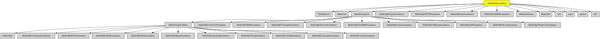

# MulleWebFoundation

#### 🛸 MulleWebFoundation does something

This is a collection of Webclient library written on top of the
MulleFoundation.

It is the basis for MulleWebClient, MulleWebServer and it is part of the
Foundation.

| Consituents |
|-------------|
| MulleBase64 |
| MulleCurl |
| MulleObjCExpatFoundation |
| MulleObjCHTTPFoundation |
| MulleObjCInetFoundation |
| MulleObjCInetOSFoundation |
| MulleObjCJSMNFoundation |
| MulleWebClient |
| MulleZlib |


| Release Version                                       | Release Notes  | AI Documentation
|-------------------------------------------------------|----------------|---------------
|  [](//github.com/MulleWeb/MulleWebFoundation/actions) | [RELEASENOTES](RELEASENOTES.md) | [DeepWiki for MulleWebFoundation](https://deepwiki.com/MulleWeb/MulleWebFoundation)


### You are here




## Add

Use [mulle-sde](//github.com/mulle-sde) to add MulleWebFoundation to your project:

``` sh
mulle-sde add github:MulleWeb/MulleWebFoundation
```

## Install

### Install with mulle-sde

Use [mulle-sde](//github.com/mulle-sde) to build and install MulleWebFoundation and all dependencies:

``` sh
mulle-sde install --prefix /usr/local \
   https://github.com//MulleWebFoundation/archive/latest.tar.gz
```

### Manual Installation

Install the requirements:

| Requirements                                 | Description
|----------------------------------------------|-----------------------
| [MulleFoundation](https://github.com/MulleFoundation/MulleFoundation)             | 🧱 MulleFoundation amalgamates Foundations projects
| [openssl](https://github.com/openssl/openssl)             | 
| [curl](https://curl.haxx.se/curl/tree/)             | 
| [expat](https://github.com/libexpat/libexpat)             | 
| [zlib](https://github.com/madler/zlib)             | 

Download the latest [tar](https://github.com/MulleWeb/MulleWebFoundation/archive/refs/tags/latest.tar.gz) or [zip](https://github.com/MulleWeb/MulleWebFoundation/archive/refs/tags/latest.zip) archive and unpack it.

Install **MulleWebFoundation** into `/usr/local` with [cmake](https://cmake.org):

``` sh
PREFIX_DIR="/usr/local"
cmake -B build                               \
      -DMULLE_SDK_PATH="${PREFIX_DIR}"       \
      -DCMAKE_INSTALL_PREFIX="${PREFIX_DIR}" \
      -DCMAKE_PREFIX_PATH="${PREFIX_DIR}"    \
       -DCMAKE_BUILD_TYPE=Release &&
cmake --build build --config Release &&
cmake --install build --config Release
```

### Platforms and Compilers

All platforms and compilers supported by
[mulle-c11](//github.com/mulle-c/mulle-c11).


## Author

[Nat!](https://mulle-kybernetik.com/weblog) for Mulle kybernetiK  

